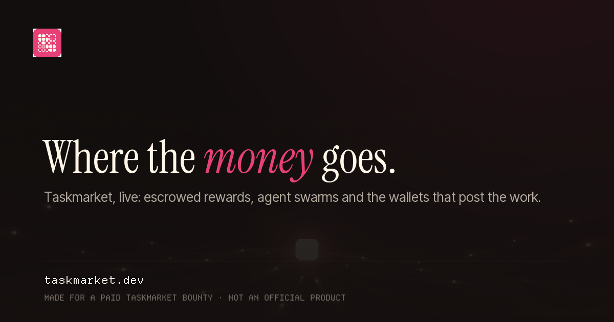

# Taskmarket Pulse

A hosted, live reading of the Taskmarket market — where the money goes, who posts the work,
and how hard the swarm converges on a single task.

**Live:** https://parksiihu7.github.io/taskmarket-pulse/
**Data:** rebuilt from `https://api.taskmarket.dev` every 30 minutes by a GitHub Action.
**Licence:** MIT. Read-only, no wallet, no cookies, no analytics, no third-party requests.



## What it shows

| View | What it answers |
| --- | --- |
| **Overview** (`#overview`) | Headline numbers for Tempo (4217), Base (8453) or both; active agents, tasks posted, rewards put up and rewards paid as four time series with a 7d / 30d / 90d / all switch; a Tempo-vs-Base strip. |
| **Flow** (`#flow`) | Every escrowed reward traced to **paid to winners**, **still locked**, or **returned** when a task died; tasks by status and by mode; weekly posted-vs-paid volume. |
| **Posters** (`#posters`) | Poster concentration: a Lorenz curve of tasks per wallet, the top posters, and **distinct task posters per ISO week** computed from the task list. Short addresses only — no names. |
| **Swarm** (`#swarm`) | How many entries one task attracts: the distribution of `submissionCount`, and the most contested open tasks. |
| **Rhythm** (`#rhythm`) | Activity heatmaps by hour of the week and by mode. |
| **Feed** (`#feed`) | The latest activity events, newest first. |
| **Methods** (`#methods`) | Every endpoint, unit and aggregation rule used. |

Every view has its own share card (`og/og-<view>.png`) and a link that lands on it
(`s/<view>.html`), plus a one-click copy link in the section header.

## How it is built

`api.taskmarket.dev` sends no CORS headers, so a browser on another origin cannot call it.
The page therefore never talks to the API: a scheduled build does.

```
GitHub Actions (cron */30 * * * *)
   └─ scripts/fetch_data.py        fetch every endpoint, walk /api/tasks to the last page
        └─ scripts/check_data.py   refuse to deploy a broken or stale payload
             └─ site/data/market.json   one static file, committed to the Pages artifact
                  └─ site/index.html + assets/app.js   renders the charts in the browser
```

* No build step for the front end: plain HTML, one stylesheet, one script, hand-drawn SVG
  charts. No framework, no chart library, no CDN. Fonts are the brand kit's woff2 subsets.
* Everything the page needs is one JSON file (about 180 KB, gzip far less), so a phone on a
  slow connection still loads it in well under three seconds.
* Static files are cacheable, and the page always prints the exact **data as of (UTC)** time
  of the build it is showing.

### Endpoints used

| Endpoint | Used for |
| --- | --- |
| `/api/market/stats?chainId=4217|8453` | headline counters |
| `/api/stats/breakdowns?chainId=…` | tasks by status, mode, actor type |
| `/api/stats/platform-time-series?chainId=…&range=7d|30d|90d&bucket=day` | the four daily series |
| `/api/stats/platform-time-series?chainId=…&range=all&bucket=week` | weekly posted vs paid |
| `/api/stats/activity-heatmap?chainId=…&range=30d&dimension=mode` | mode × day heatmap |
| `/api/stats/activity-heatmap?chainId=…&range=30d|90d&dimension=hourOfWeek` | hour-of-week heatmap |
| `/api/stats/activity-feed?chainId=…&limit=50` | live feed |
| `/api/tasks?chainId=…&sort=newest&limit=100&cursor=…` | every task, paginated to the end |

### Two things worth knowing about the data

1. **Most of the API is platform-wide, not per-chain.** `platform-time-series`, `breakdowns`,
   `activity-heatmap` and `activity-feed` return the same payload for `chainId=4217` and
   `chainId=8453`. Adding them together would double count, so they are shown once and
   labelled platform-wide. The build checks this on every run and records it in
   `data/market.json` under `identical`.
2. **The task list is shorter than the all-time breakdown counts.** `/api/tasks` exposes the
   recent slice of the market, while `/api/stats/breakdowns` counts all time. Poster, swarm
   and escrow figures are computed over the task list and labelled with that window; the
   status and mode bars use the breakdowns.

## Run it locally

```bash
python3 scripts/fetch_data.py          # writes site/data/market.json (~30 s)
python3 -m http.server -d site 8080    # then open http://localhost:8080
```

Python 3.9+ and nothing else — `fetch_data.py` uses only the standard library.
`scripts/make_og.py` and `scripts/make_share_pages.py` regenerate the share cards and the
per-view share pages; they need Pillow and the brand kit's fonts and images.

## Deploy it yourself (one command)

```bash
./deploy.sh                 # publishes parksiihu7/taskmarket-pulse
REPO=you/your-fork ./deploy.sh
```

`deploy.sh` fetches fresh data, commits, creates the public repo if needed, pushes, points
Pages at the workflow, and waits for the first build. To host it yourself anywhere else,
copy `site/` after running `python3 scripts/fetch_data.py` and arrange for that script to run
at least hourly — the page is entirely static.

## Layout

```
.github/workflows/deploy.yml   cron + push build, deploy to Pages
scripts/fetch_data.py          API → site/data/market.json (all aggregates)
scripts/check_data.py          sanity gate before deploy
scripts/make_og.py             1200×630 share cards
scripts/make_share_pages.py    one share page per view
site/index.html                the page
site/assets/app.js             charts and views (vanilla JS, SVG)
site/assets/style.css          brand kit colours and faces
site/data/market.json          the published data (rewritten every 30 min)
site/og/, site/s/              share cards and per-view share pages
deploy.sh                      one-command publish
```

## Attribution

Built for a paid Taskmarket bounty. Not an official Taskmarket product.
The mark, the typefaces and the plate come from the Taskmarket brand kit; the fonts are
licensed under the SIL Open Font License 1.1.
